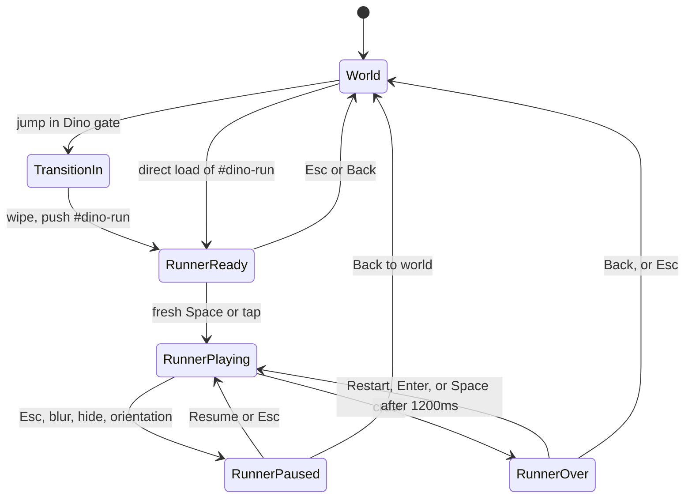

# Dino Run

## 1. Approach and decisions

Keep the overworld. React still owns the mode. [`src/game/Game.js`](src/game/Game.js) still owns the desert loop. A new `RunnerGame` owns the runner loop on the **same canvas** and the **same** `GameInput` and sprite image. Only one loop runs: `loopMode === 'runner'` makes `Game._isLoopActive()` false, then `RunnerGame` starts its own rAF. On exit, stop the runner first, then `setLoopMode('world')`.

Do not import [`reference/dino_game/`](reference/dino_game). Copy the numbers into JS, the same way [`src/game/atlas.js`](src/game/atlas.js) already does.

Decisions, and what was rejected:

- **No jump during a run.** Up/Down is the only dodge. A hop that does not move the 28×12 footprint cannot dodge (that is how overworld jump already works). A hop that lifts the footprint is a different game and would make cacti optional. Birds (R5) are ground-plane hazards so they do not need a jump.
- **Back to world is the second game-over action.** A Portfolio button is not built. It would duplicate Skip / `#plain`, and it would leave the player unsure which desert gate they came from. Trade-off of adding it later: one extra DOM button, no new scene.
- **Restart starts the next run immediately** (Chromium `restart()`), with the button-press sound. The press-space ready state is only for the first entry, so the Space that hopped into the gate cannot also start the run.
- **Night invert is out.** `invertDistance` 700 and a 12s fade exist in the reference, and the color jump is harsh next to this site’s day desert. No milestone for it.
- **No backend leaderboard.** This is a static Vite app with no account, no abuse control, and no host. HI is a local number, which is also what Chromium does.
- **Do not apply `mobileSpeedCoefficient`.** The runner scale rule already widens the view. Slowing speed again on phones would double-compensate.
- **Skip the intro walk.** The dino is already at its play x in the ready state. Chromium’s `startXPos` slide is not used.
- **Cactus hitboxes are base footprints, not the sprite collision boxes.** The boxes in `obstacle.ts` are reported below and are not the runner test. Clusters still multiply width, matching `typeConfig.width * size`.
- **One corridor per row.** Footprint count is `ceil(blockedDepth / footprintDepth)` on an 84 px track. Every other gap is packed under 4 px, which is narrower than the dino’s 12 px depth plus 2 px, and narrower than the inset hitbox, so forgiveness cannot open a second hole.
- **Fairness is a ceiling, not the difficulty dial.** Free distance is `gap - 28`. `T_REACT` stays **0.20 s** and the fair fraction stays **0.9**. A falling reaction time would cancel the rising speed and leave the small-cactus ceiling almost flat, so those two stay constant. Difficulty is a separate shift-ambition ramp (0.25 of the cap at score 0, the whole cap at score 1000) and a corridor shrink from 46 px to 28 px over score 0–1500.
- **Escape is always a runner action.** Space and Enter yield to a focused button, link, or input. Escape does not, unless a modal dialog is open. Starting a run, including a mouse click on Restart, moves focus back to the canvas so Up/Down work on the next key.
- **Slow mode has its own HI.** A slow run writes `ethan-rose.dinoRun.hiSlow` only. It never updates the normal HI or the desert-gate label.
- **North desert layout stays put.** Ground and props for `y < 540` keep today’s counts and `WORLD_SEED` streams. The new south band uses a second seed. Changing `GROUND_BOTTOM` inside the current generator would reshuffle the whole desert.

## 2. Files

New:

- [`src/game/clock.js`](src/game/clock.js) — `frameDelta(now, last)` clamped to `0.05`. Both loops use it.
- [`src/game/runner/constants.js`](src/game/runner/constants.js) — scale, track, speed, gaps, storage keys.
- [`src/game/runner/scoring.js`](src/game/runner/scoring.js) — `distanceRan`, score, 100-point flash. No DOM.
- [`src/game/runner/difficulty.js`](src/game/runner/difficulty.js) — speed step, fairness ceiling, shift ambition, corridor length.
- [`src/game/runner/spawner.js`](src/game/runner/spawner.js) — rows, original gap formula, seeded RNG, fairness clamp.
- [`src/game/runner/simulate.js`](src/game/runner/simulate.js) — sub-stepped footprint test. No DOM.
- [`src/game/runner/storage.js`](src/game/runner/storage.js) — `localStorage` in try/catch, memory fallback.
- [`src/game/runner/RunnerGame.js`](src/game/runner/RunnerGame.js) — ready / playing / over / paused, draw, handoff.
- [`src/components/RunnerOverlay.jsx`](src/components/RunnerOverlay.jsx) — prompts, pause, game-over buttons, mute, slow mode, aria-live.
- [`test/runner/scoring.test.js`](test/runner/scoring.test.js), [`test/runner/spawner.test.js`](test/runner/spawner.test.js), [`test/runner/simulate.test.js`](test/runner/simulate.test.js).

Changed:

- [`src/game/constants.js`](src/game/constants.js), [`src/game/atlas.js`](src/game/atlas.js), [`src/game/input.js`](src/game/input.js), [`src/game/scale.js`](src/game/scale.js)
- [`src/game/Game.js`](src/game/Game.js), [`src/game/entities.js`](src/game/entities.js), [`src/game/ground.js`](src/game/ground.js), [`src/game/props.js`](src/game/props.js)
- [`src/App.jsx`](src/App.jsx), [`src/components/World.jsx`](src/components/World.jsx), [`src/components/TouchControls.jsx`](src/components/TouchControls.jsx)
- [`package.json`](package.json) — `"test": "node --test"` (Node discovers `*.test.js` itself; a quoted glob is not expanded by Windows shells on older Node)
- [`THIRD_PARTY_NOTICES.md`](THIRD_PARTY_NOTICES.md)

[`reference/dino_game/`](reference/dino_game) stays read-only.

## 3. State machine and routing

React `mode` gains `'runner'`. Ready, playing, crashed, and paused live inside `RunnerGame`. They do not each get a hash.



Hash rules, still only through `syncFromLocation()` in [`src/App.jsx`](src/App.jsx):

- `#dino-run` is handled **before** the “unknown hash means world” branch. Today that branch would swallow it.
- Gameplay enter: same hop and apex wipe as the section gates (`beginEnterTransition`, `WIPE_MS`). At the end, `pushState('#dino-run')` and `syncFromLocation()`. Do not open the dialog. Do not add `'dino'` to `visited`.
- Direct load or Forward onto `#dino-run`: no hop. Overworld pauses. Runner starts in ready. `pushedEntryRef` stays false.
- Back / Esc / BACK TO WORLD: if this visit pushed the hash, `history.back()`; otherwise `replaceState('#world')`, same deep-link guard as sections. `placeDinoAtReturn('dino')` puts the dino **north** of the gate (`y - 72`, not the section gates’ `y + 72`). Announce “Back in the desert, at the Dino Run portal.” Focus the canvas.
- Space latch: on entering ready, clear `jumpQueued`. If Space or the touch jump is still held, ignore it until release. The next new press starts the run. Restart does not return to ready.

`Game.setLoopMode('runner')` pauses the desert the same way `'section'` does. `RunnerGame` gets `game.sprite`, `game.input`, and the canvas. Resize still flows through the existing `ResizeObserver` in [`src/components/World.jsx`](src/components/World.jsx) and is forwarded while the runner is active.

## 4. Runner scene

### Scale and camera

Overworld `computeScale` stays. It yields about 195–480 game px of width, and at 360–780 px/s that is not enough look-ahead.

Runner scale, integer device pixels, same `setTransform(S, 0, 0, S, 0, 0)` and `imageSmoothingEnabled = false` as [`src/game/scale.js`](src/game/scale.js):

```
bufferW, bufferH = device pixel box (existing ResizeObserver path)
S_run = max(1, min(round(bufferW / 600), floor(bufferH / 180)))
visibleW = bufferW / S_run
visibleH = bufferH / S_run
```

`bufferW / 600` is the backing-store width, not CSS width. CSS width alone would make a dpr-3 phone a 1000px-wide world of tiny pixels. The height term keeps the 180 px playfield from clipping on a short, wide window: a 1400×200 buffer gets `round(1400/600) = 2` and `floor(200/180) = 1`, so `S_run` is 1 and the playfield fits. When `bufferH < 180`, `floor` is 0 and `max(1, …)` still yields 1, so the band is top-aligned and clipped. That is only a window shorter than 180 device pixels.

This lands near 600 game px of width when the window is tall enough (about 480–750 from dpr 1 to 3). On a short window the height cap wins and the view gets wider, which adds look-ahead.

Playfield height is fixed at **180** game px, centered vertically in the canvas when `visibleH > 180`. The margin is `#f7f7f7`. From the top of that band: sky `0–36`, horizon line at `y = 36`, track `y = 52–136` (depth **84**), bottom pad `44`.

Dino screen x is `clamp(round(visibleW * 0.12), 48, 96)`. The camera x scrolls at the game speed so the dino stays on that x. There is no x input.

Resize and orientation change while playing enter **paused** (state frozen, no catch-up dt). First layout does not pause. dpr 1, 1.25, 1.5, 2, and 3 all use the same integer `S` path as the desert.

### Movement

- `LANE_SPEED = 240` px/s, same constant feel as overworld `MOVE_SPEED`.
- Axis is vertical only. Up decreases foot y. Clamp foot y to the track band (`52 + 12` through `136`).
- Dino footprint stays **28 wide × 12 deep**. Obstacle footprints are **10 deep** (small) or **12 deep** (large). Cluster size multiplies width only.
- Ready and paused: standing frame, blink `1000/3` ms, delay 3000–7000 ms. Playing: run frames `88` and `132` at `1000/12` ms for the whole run. Crashed: source x offset **220**.
- Draw order: sky, horizon, clouds, then dino and cacti sorted by foot y. Smaller foot y draws first.

### Reference numbers (confirmed)

From [`offline.ts`](reference/dino_game/offline.ts) normal mode: speed **6** px/frame, maxSpeed **13**, acceleration **0.001** per frame, gapCoefficient **0.6**, maxObstacleLength **3**, maxObstacleDuplication **2**, clearTime **3000** ms, gameoverClearTime **1200** ms, maxClouds **6**, cloudFrequency **0.5**, invertDistance **700**, invertFadeDuration **12000** ms. Slow mode: speed **4.2**, maxSpeed **9**, acceleration **0.0005**, gapCoefficient **0.3**.

Integrate in 60fps-frame units so a 120Hz display matches Chromium’s per-frame acceleration:

```
frames = dt * 60
distanceRan += speed * frames
if (speed < maxSpeed) speed += acceleration * frames
```

Chromium adds acceleration once per `update()` and ignores dt. Multiplying by `frames` is the dt-correct version of that.

Score, from [`distance_meter.ts`](reference/dino_game/distance_meter.ts): `round(ceil(distanceRan) * 0.025)`. Five digits. Achievement every **100**. Flash **250** ms off / **250** ms on, **3** iterations (1.5 s), sound once when the achievement starts. A 50 ms spike at max speed adds under 1 score point, so a boundary is not skipped. Cap the drawn score at **99999** (Chromium would add a sixth digit; the requested HUD does not).

Gap, from [`obstacle.ts`](reference/dino_game/obstacle.ts):

```
minGap = round(rowWidth * speed + minGapConst * gapCoefficient)
maxGap = round(minGap * 1.5)
gap = randInt(minGap, maxGap)
```

Spawn the next row when `rowX + rowWidth + gap` has reached the right edge of the playfield (Chromium’s `followingObstacleCreated` test). `maxGapCoefficient` is **1.5**.

Slow mode detail to copy, or slow mode gets harder than Chromium: [`obstacle.ts`](reference/dino_game/obstacle.ts) **doubles** `gapCoefficient` when slowdown is on. Config `0.3` becomes an effective **0.6**, the same as normal, while speed stays lower. Do that.

### Obstacle table (ldpi, from [`offline_sprite_definitions.ts`](reference/dino_game/offline_sprite_definitions.ts))

These boxes are the original sprite boxes. The runner does not use them for the hit test.

- Small cactus: 17×35, yPos 105, multipleSpeed **4**, minGap **120**, minSpeed **0**. Boxes `(0,7,5,27)`, `(4,0,6,34)`, `(10,4,7,14)`.
- Large cactus: 25×50, yPos 90, multipleSpeed **7**, minGap **120**, minSpeed **0**. Boxes `(0,12,7,38)`, `(8,0,7,49)`, `(13,10,10,38)`.
- Pterodactyl: 46×40, yPos desktop `[100, 75, 50]`, mobile `[100, 50]`, multipleSpeed **999**, minSpeed **8.5**, minGap **150**, 2 frames at `1000/6` ms, `speedOffset` **±0.8**. Boxes `(15,15,16,5)`, `(18,21,24,6)`, `(2,14,4,3)`, `(6,10,4,7)`, `(10,8,6,9)`.
- Group crop, from `obstacle.ts` `draw()`: `sourceX = spriteX + width * size * (size - 1) / 2`, source width `width * size`. Small at x 228: size 1 → 228×17, size 2 → 245×34, size 3 → 279×51. Large at x 332: 332×25, 357×50, 407×75. Size above 1 is rejected when `speed < multipleSpeed`. Same type at most **2** times in a row (`maxObstacleDuplication`).

Runner footprints: small base **17 wide × 10 deep**, large base **25 wide × 12 deep**, times cluster size on width. The overworld’s 6 px and 8 px bases stay in the desert. A runner row is a depth stack of these footprints at one x, with exactly one corridor.

### Spawner and director

No rows until `runningTime > 3000`. Clouds and the horizon still scroll.

The old “2–4 footprints of 6–8 px” layout only covered 9–24% of a 132 px band, which cannot be a 0.45–0.72 block and cannot be one corridor. The track is **84** px deep instead. Blocked depth is whatever the corridor does not use. Footprint count is computed, not rolled as a small integer.

```
corridorRamp = clamp(score / 1500, 0, 1)
corridor     = lerp(46, 28, corridorRamp)   // never below 28
blocked      = 84 - corridor
count        = ceil(blocked / footprintDepth)
```

`footprintDepth` is 10 for a small cactus and 12 for a large one. A block fraction of 0.72 on this band would leave a 23.5 px corridor, under the 28 px floor, so it is not used. The densest legal row blocks `(84 - 28) / 84 ≈ 0.67`.

Each row:

- One type, duplication cap 2, cluster size 1–3 under the `multipleSpeed` gates. Cluster size changes width, not depth. Each of the `count` slots is one cluster.
- Exactly one gap that can hold the dino. Every other seam is packed to at most **4** px. That is narrower than `12 + 2 = 14`, and narrower than the inset hitbox (12 − 4 = 8), so the 2 px forgiveness cannot make a second corridor.
- The fairness cap is only a ceiling. The center actually moves by a rolled fraction of that ceiling (the ambition ramp below). Then clamp the center so the whole corridor stays inside the band.

Speed ramp, unchanged from Chromium: `speed = min(13, 6 + 0.001 * frames)`. It hits 13 at frame 7000. `7000 / 60 ≈ 117 s`. Distance covered is about `6*7000 + 0.001*(6999*7000/2) ≈ 66500` px, and `round(66500 * 0.025) ≈ 1660`. After that, speed stays 13.

The fairness ceiling is not how the run gets harder. With `T_REACT` falling from 0.30 to 0.15 while speed rises, the small-cactus ceiling stays about **4–6 px** at the minimum gap and about **25 px** at the average gap from score 0 to 1000. The falling reaction budget cancels the rising speed. Those two knobs stay constant instead:

- `T_REACT = 0.20`
- fair fraction `= 0.9`

Difficulty is two other ramps:

- Shift ambition: `lerp(0.25, 1, clamp(score / 1000, 0, 1))`. Each corridor shift is `(rng * 2 - 1) * ambition * cap`. At score 0 the roll uses a quarter of the ceiling. At score 1000 it may use the whole ceiling. It never exceeds the ceiling.
- Corridor length: 46 px at score 0, linear to **28** at score **1500**, then stays 28. This finishes before the speed plateau (score ~1660, speed still about 12.5 at score 1500).

Worked row counts (corridor ramp only; cluster size does not change depth):

```
score   corridor  blocked  small count (10)  large count (12)
0             46       38                 4                 4
1000          34       50                 5                 5
1500          28       56                 6                 5
```

At speed 6 a large cactus is still size 1 (`multipleSpeed` 7). At speed 13 it may be size 3. That changes the scroll-axis width and the gap, not the depth count.

Text sketch of the speed-6 small row (84 px, four 10 px footprints, one 46 px corridor). Far is the top. The first two footprints overlap by 2 px so the union fits the band. Every seam except the corridor is 0 px.

```
y=0   [####] cactus 10
y=8   [####] cactus 10     overlaps the one above
y=18  [####] cactus 10     flush with the one above
y=28  [    corridor 46    ]   the only gap >= 14
y=74  [####] cactus 10
y=84
```

Union of the three-stack is `y = 0–28` (28 px) plus `y = 74–84` (10 px) = 38 px blocked. `ceil(38 / 10) = 4`. One corridor.

Fairness window is the time after the dino has cleared row 1 and before it reaches row 2. `gap` is the empty distance from the right edge of row 1 to the left edge of row 2. The dino is 28 px wide along the scroll, so the free run is `gap - 28`:

```
free     = gap - 28
freeTime = free / (speed * 60)
|y2 - y1| / 240 + T_REACT <= fair * freeTime
```

`T_REACT` is 0.20 and `fair` is 0.9 on every row. If the right side cannot hold `T_REACT`, add to `gap` until a shift of 0 is legal, then keep the corridor center. The rolled shift is then clamped to `ambition * cap`.

Small-cactus ceiling at those constants. Average gap is the midpoint of `minGap` and `round(minGap * 1.5)`. At speed 6 that is about **40 px** on the minimum gap and about **66 px** on the average gap (the ~60 px average is this figure). The ceiling still changes with speed. It is not held flat, and it is not the dial.

```
small x1          minGap   avg gap   cap at min   cap at avg
speed 6              174       218           40           66
speed 13             293       367           25           46
```

Same ceiling for the other types, minimum gap, before the band clamp:

```
type        speed 6   speed 13
large x1         68         54
large x3        248        234   then the 84 px band clamps the center
```

Large x3 is not spawned at speed 6 (`multipleSpeed` 7).

What a run is allowed to roll, small x1, `ambition` times that ceiling:

```
score    ambition   speed   max |shift| at min gap   at avg gap
0            0.25       6                      10           16
1000         1.00    ~10.8                      28           49
```

Score 1000 is about frame 4770, speed about 10.8. From there the roll may use the whole ceiling. The corridor is still shrinking until score 1500.

Seed: `createRng` from [`src/game/rng.js`](src/game/rng.js), seed stored on the run (`Date.now()` in play, fixed in tests).

### Tuning (starting values)

- `S_run = max(1, min(round(bufferW / 600), floor(bufferH / 180)))`. Playfield height 180. Track depth 84 (`y = 52–136`). Dino x 12% clamped 48–96.
- `LANE_SPEED` 240. Corridor 46 → 28 over score 0–1500. Footprint depth 10 small / 12 large. Other seams ≤ 4 px.
- `T_REACT` 0.20, constant. Fair fraction 0.9, constant. Shift ambition 0.25 → 1.0 over score 0–1000.
- Speed 6 → 13, accel 0.001 / frame, plateau at frame 7000. Slow: 4.2 → 9, accel 0.0005, effective gap coefficient 0.6. Slow uses the same ceiling, ambition, and corridor curves.
- `clearTime` 3000. `gameoverClearTime` 1200. Forgiveness inset **2** px per side on the dino box.
- Clouds: max 6, frequency 0.5, gap 100–400, sky y 4–28 inside the playfield, `elSpeed = 0.2/1000 * dtMs * speed` then ceil, matching [`cloud.ts`](reference/dino_game/cloud.ts). Use the existing filled cloud from `buildCloudSprite`, so the runner matches the desert rather than the hollow sheet.
- Horizon: crop `(2, 52)`, 600×12, two segments, scroll `floor(speed * frames)`, matching [`horizon_line.ts`](reference/dino_game/horizon_line.ts).

### Collision

Test the inset dino box against each obstacle base footprint. Sub-step at `<= 1/120` s (a clamped 50 ms tick is 6 steps). At max speed one step moves `13 * 0.5 = 6.5` px, which is less than the 17 px cactus, so a frame spike cannot tunnel. No new physics library. `boxesOverlap` in [`src/game/collision.js`](src/game/collision.js) stays the primitive.

### HUD and storage

Screen-space, top-right of the playfield, y = 5. Digit crop `(655 + 10*d, 2, 10, 13)`, dest step **11**. `H` is index 10 at x 755, `I` is index 11 at x 765. Draw `HI` plus five digits at alpha 0.8, then the current five digits. Layout matches `DistanceMeter.calcXpos`: current score’s right edge sits `11 * 6` px in from the playfield’s right edge.

Keys: `ethan-rose.dinoRun.hi`, `ethan-rose.dinoRun.hiSlow`, `.muted`, `.slow`. Read/write in try/catch. On failure, keep the value on the `RunnerGame` instance for the session. The desert label and a normal run read `.hi` only. A slow-mode run reads and writes `.hiSlow` only, and it does not change `.hi` or the gate. Format `HI 00123` (zeros to 5). A missing score draws `HI 00000`.

## 5. Ready and game over

Ready: dino stands and blinks, scroll speed 0, DOM prompt “PRESS SPACE TO START” or “TAP TO START” (Press Start 2P, 16px). The sheet cannot spell that sentence.

Game over: freeze scroll and speed. Dino frame 220. Canvas draws the sprite text only: crop `(655, 15, 191, 11)`, centered, `y = round((180 - 25) / 3)` inside the playfield (the reference `textY` 13 and size 191×11 on `textSprite`). The frozen HI and last score stay on the digit HUD.

The restart icon is a DOM button, not a second canvas sprite. Reuse the [`ExitButton.jsx`](src/components/ExitButton.jsx) crop `(2, 68, 36, 32)` at `36N×32N` device pixels. Frame 0 only. The spin offsets in `game_over_panel.ts` (`0, 36, 72, …, 252`) stay unused until that strip is checked on screen, which is already the project rule. Beside it, a Press Start 2P button “BACK TO WORLD”. Both sit under the sprite text, in the letterbox when there is one, over the playfield when the window is short. They are real buttons. Enter and Space activate whichever button is focused, through the browser, not through the game handler. Escape does not activate a button. It stays the runner action even when Restart, Resume, or Back is focused.

Input while crashed, matching [`offline.ts`](reference/dino_game/offline.ts) `onKeyUp`: Enter restarts immediately when the target is the canvas or the body. Space and a canvas tap restart only after **1200** ms. A click on the Restart button is immediate, and so is Enter while that button is focused (the button’s own click, once). Back to world is immediate. Space or Enter on the focused Restart button does not also run the canvas path.

Starting a run moves focus to the canvas synchronously, including a mouse click on Restart. The next Up or Down then moves the dino. The player does not have to click the canvas first.

Esc: ready and game over exit to the desert immediately. During a run, Esc pauses (Resume, Back to world). Esc again resumes. It does not exit, so a double Esc cannot dump the player out mid-run. Blur, `document.hidden`, and an orientation-changing resize use the same pause. Resume does not integrate the time spent away and clears held keys first. That is the fair resume: the obstacle that was on screen is still where it was.

## 6. Overworld

[`src/game/constants.js`](src/game/constants.js) today is `960×560`, ground `y = 120–540`, spawn `(480, 430)`, gates at `(220, 300)`, `(480, 190)`, `(740, 300)`.

- `WORLD_HEIGHT = 780`, `GROUND_BOTTOM = 760`. Walk clamp already uses `GROUND_BOTTOM`. Width, sky, spawn, and the three gates stay.
- Dino gate center **`(480, 660)`**. Return **`(480, 588)`** (`660 - 72`). Trigger top is about `y = 632`, so the return footprint does not sit in the trigger. `GATE_OPENING_CLEAR_PX` (90) already covers that point, so props will not spawn on it.
- Keep the 48 px gap, 40×28 trigger, and jump-to-enter test. Cue string: “Dino Run. Press Space to enter.” Coarse pointer: “Dino Run. Tap jump to enter.”
- Look: same two large posts and the same trigger math, **no small outer flanks** (that pair is the section-gate silhouette). A pterodactyl flaps in place above the gap (frames 134 and 180, `1000/6` ms, ±18 px), with no collider. A short horizon strip lies on the ground through the opening. Label is two DOM lines, `DINO RUN` and `HI 00000`, class `portal-label--dino`, never `portal-label--visited`.
- [`src/game/ground.js`](src/game/ground.js) draws spawn→gate dots for every `PORTAL_DEFS` entry. The dino gate is a separate def with `path: false`, excluded from that loop and from the prop path-clear in [`src/game/props.js`](src/game/props.js). Opening clear still applies. No off-screen edge hint for this gate (the CSS for hints exists; the JSX does not render them today, and this gate must not grow one).
- Ground and props: run the current generator with the old bottom `540` and the old counts, then fill `y = 540–760` from `WORLD_SEED + 11`. Clouds are screen-space and need no change. Camera headroom formula stays `clamp(147 / visibleH, 0.5, 0.85)`. A taller world only means the camera can scroll south before it hits the clamp; portrait phones letterbox less.

`visited` stays the three section ids. The HUD is currently the “ETHAN ROSE” link, not a visible `n/3`. Exclusion means: do not insert `'dino'` into that set, and do not invert this label as a visited section.

## 7. Input, touch, audio, accessibility

Extend [`src/game/input.js`](src/game/input.js). Do not add a second window listener.

- `setAxisMode('plane' | 'vertical')`. Vertical mode forces axis x to 0. Keyboard still uses `event.code`, ignores `repeat`, and clears on blur and hide.
- New edges, consumed once per frame: Enter, Escape, KeyM.
- Space and Enter yield when `event.target` is a `button`, an `a`, an `input`, or `[role=button]`. The handler does not `preventDefault` those two and does not treat them as game actions. Native activation of Restart, Back, Resume, mute, Skip, and the name link keeps working. A focused Restart button plus Space restarts once.
- Escape does not yield to those targets. It remains a runner action while the runner is active: exit from ready and game over, pause during a run, resume from pause. That includes focus on Restart, Resume, or Back. The one exception is an open modal dialog (`dialog[open]`, the section dialog). Then Escape is left to the dialog and is not a runner action.
- `preventDefault` for arrows, Space, and Enter only when the target is the canvas or the body, and only while that loop wants the keys (desert playing, or the runner playing). A section dialog still scrolls normally. `preventDefault` on Escape while the runner is active, including when a button is focused, and not while a dialog is open. Movement keys are ignored when the target is a button, link, or input, so a focused Restart does not also slide the dino. As soon as a run starts, focus is on the canvas, so the next Up or Down does move it.
- [`TouchControls.jsx`](src/components/TouchControls.jsx) gains `axisLock="vertical"` (zero x before `setTouchAxis`). Hide the JUMP button in the runner. Tap on the canvas is the start/restart gesture, with the same release latch and the 1200 ms crash delay. Pointer capture and the 0.2 deadzone stay.

Audio, milestone R6, files named in [`THIRD_PARTY_NOTICES.md`](THIRD_PARTY_NOTICES.md): `public/sounds/button-press.mp3` (start and restart), `hit.mp3` (crash), `score-reached.mp3` (each 100). Muted **by default**. M and a visible button toggle it. Persist the flag. Unlock on the first runner gesture via `HTMLAudioElement.play()`, and ignore rejection. Chromium’s `loadSounds()` returns immediately on iOS and never plays. We still try after a gesture. If iOS or the silent switch rejects `play()`, stay silent. Score flash and the bird telegraph are visual, so silence is not a fairness bug. Confirm the three files are actually on disk before R6 (the notices list them; they were not in the workspace file search).

Accessibility:

- One polite live region: “Game started.” “Paused.” “Game over. Score 87. High score 123.” Exit announcement already specified.
- Canvas `aria-label` describes the current controls (up/down, Space, Esc).
- Game-over and pause buttons are in tab order. Focus the Restart button when a run ends, so a keyboard user lands on a button. Focus the canvas when a run starts, including Restart by mouse or by the button’s own Enter/Space, and when returning to the desert. Space and Enter on a focused button are the button’s own click. Enter still restarts immediately when focus is on the canvas or the body. Space from the canvas still waits 1200 ms. Escape still exits or pauses when Restart, Resume, or Back is focused.
- `prefers-reduced-motion`: a short dismissible note, “This game scrolls. Slow mode is available.” Do not block play. Offer the slow-mode toggle (the numbers above). Ready-state blink and the gate pterodactyl freeze, matching the desert. The run cycle and the scroll stay, because freezing them makes the game unreadable. The note is the accommodation.

## 8. Test plan

`node --test` (script is exactly that; no glob). Pure modules only. No canvas, no `localStorage`, no `assetUrl`.

- Scoring: `round(ceil(distance) * 0.025)`; flash fires once when the score lands on a new multiple of 100; speed after `n` frames is `min(13, 6 + 0.001 * n)`; speed is 13 at frame 7000 and the score there is about 1660.
- Gap: the formula matches the hand values above (small at speed 13 → minGap 293; large size 3 at speed 13 → 1047). The ceiling uses `gap - 28`, `T_REACT` 0.20, and fair fraction 0.9. Small x1 is about 40 px at speed 6 on the minimum gap and about 66 px on the average gap, and about 25 px / 46 px at speed 13.
- Spawner, seeds 1 and 2: no row before 3 s; every consecutive pair obeys the ceiling; the rolled `|shift|` is at most `ambition * cap`, with ambition 0.25 at score 0 and 1 at score 1000; exactly one gap is ≥ 14 px and every other seam is ≤ 4 px; corridor length is 46 at score 0, 34 at score 1000, and 28 at score 1500; `count === ceil(blocked / footprintDepth)`; cluster size is 1 until `multipleSpeed`.
- Five-minute bot: it sits in the corridor it just cleared, and it may start moving toward the next corridor only `T_REACT` after that clear (the free window is `gap - 28`). It moves at `LANE_SPEED` and never teleports. It survives 300 s with zero collisions on the normal ramp and on the slow ramp. A bot that starts moving at the clear instant is not the test.
- Sub-step: a 17 px cactus and a dino closing 39 px in one 50 ms tick still overlap.

Browser-only, per milestone: crops, integer scale at dpr 1–3, letterbox, history Back/Forward, the Space latch, pause on blur, focus order, touch, and audio unlock.

## 9. Milestones

Each one is playable on its own.

**R1 — Gate and routing.** Extend the map, add the gate (flanks, bird, label with HI 00000, no path, not in `visited`), hop, wipe, `#dino-run`, pause the desert, ready stub with Back. Acceptance: the three old gates still open sections; walking into the dino gate does nothing; jumping in does; the dirt path does not point at it; Back and a direct load of `#dino-run` both end in one state; a deep link does not leave the site; return spawn is north of the gate and not inside the trigger.

**R2 — Runner core.** Scale with the height cap, letterbox, fixed dino x, horizon and clouds, up/down, ready prompt, Space latch, run animation, score HUD, speed ramp, pause on hide/blur/orientation. No cacti yet. Acceptance: a 390 px-wide dpr-3 view is roughly 500–700 game px wide; a short wide buffer uses `floor(bufferH / 180)` and the 180 px band is fully on screen; the dino cannot leave the 84 px band; the Space that entered does not start the run; score ticks with `0.025`; hiding the tab freezes the score and does not jump it on return.

**R3 — Rows, death, HI.** One-corridor cactus rows (`ceil(blocked / footprintDepth)`), sub-step collision, crash frame, GAME OVER crop, restart and back buttons, normal HI in `localStorage` and on the desert label. Acceptance: a crash stops the scroll; Enter on the canvas restarts before 1200 ms and Space on the canvas does not; Space on the focused Restart button restarts once; after a mouse click on Restart, focus is the canvas and the next Up or Down moves the dino with no extra click; Escape still leaves the run while Restart or Back is focused; the desert label shows the new HI after a normal run; a 50 ms spike cannot pass through a 17 px cactus.

**R4 — Director and tests.** Fairness ceiling on `gap - 28` at `T_REACT` 0.20 and fair fraction 0.9, ambition ramp, corridor ramp, duplication cap, `node --test`, the 5-minute bot that waits `T_REACT`. Acceptance: the test fails if a rolled shift exceeds `ambition * cap`, if ambition is ignored and every shift uses the full ceiling from score 0, or if the bot is allowed to move at the clear instant; `npm test` passes with no browser.

**R5 — Birds.** Optional. See section 10. Acceptance: no bird before speed 8.5; the row has a partial cactus stack and the shadow sits inside that opening, flush to one wall, leaving one safe slot; a shadow alone with a ~72 px hole does not occur; the blink marker appears at the shadow’s depth before the row enters; a bot that aims at the safe slot, not at the whole opening, still survives.

**R6 — Touch, audio, slow mode, focus.** Vertical stick, tap to start, mute, the three sounds, reduced-motion note, focus moves. Acceptance: keyboard-only can start, pause, restart, and leave; Space and Enter on a focused Restart, Resume, or Back button do not also run the canvas path; Escape still pauses, resumes, or leaves while those buttons are focused, and does not steal Escape from an open section dialog; mute survives reload; a failed `play()` does not throw; slow mode uses 4.2 / 9 / 0.0005 and the doubled gap coefficient; a slow-mode record updates `hiSlow` and leaves the gate’s HI unchanged.

**R7 — Polish and credit.** Crop check at dpr 1.25 and 1.5, south-band density, [`THIRD_PARTY_NOTICES.md`](THIRD_PARTY_NOTICES.md) lists the runner crops (digits, HI, GAME OVER, restart, cactus groups, pterodactyl, cloud, horizon, dino frames). Acceptance: the north desert is the same layout as before the extension; notices match the crops in `atlas.js`.

## 10. Birds (R5) and risks

A bird row is a partial cactus stack plus a shadow inside the opening. A 12 px shadow alone leaves about 72 px of open track, which is a trivial dodge, so that layout is not used.

The opening is `corridor + 12` px (58 px at score 0, 40 px at score 1500). The cactus count is `ceil((84 - opening) / footprintDepth)`, which is 3 small footprints at score 0 and 5 at score 1500, fewer than a pure cactus row at the same score. The shadow is 12 px deep and 46 px wide, flush against one cactus wall of the opening. The other side of the shadow is one safe slot of exactly `corridor` px (46 down to 28). Nothing passable sits on the far side of the shadow. Seams between cacti stay at most 4 px. The fairness ceiling and the ambition ramp apply to the safe slot’s center, not to the center of the whole opening.

The sprite flaps in the sky above that shadow (frames at 134 and 180). The row is one x and scrolls at ground speed. The original `speedOffset` of ±0.8 is not used, because the shadow has to stay inside the cactus opening. Only after speed ≥ 8.5. For ~600 ms before the row enters, a 1 px marker blinks on the right edge at the shadow’s depth. Map the three original altitudes `[100, 75, 50]` to where the opening sits in the band (far, middle, near). The shadow stays flush to one wall of that opening, so it never splits the safe slot into two gaps.

Sketch at score 0, small cacti. Union of the three footprints is y 0–26. The safe slot is the only gap the dino can use.

```
y=0   [####] cactus 10
y=8   [####] cactus 10
y=16  [####] cactus 10
y=26  [     safe slot 46     ]
y=72  [shadow 12, flush to the slot]
y=84
```

Rejected: a shadow as the only block, a bird that covers the whole band (unavoidable, because x is locked), and a jump used only for birds. A bird row that is only another full cactus row does not need the sprite.

Risks:

- Two rAF owners. The handoff must cancel one before starting the other, including StrictMode’s double mount. `RunnerGame.destroy()` cancels the frame and removes nothing the desert still needs (the input listeners stay on `Game`).
- `syncFromLocation` treats unknown hashes as the desert. `#dino-run` has to be explicit.
- The enter Space is still in `jumpQueued` unless ready clears it.
- Extending `GROUND_BOTTOM` inside the current RNG loop reshuffles the north. The split generator is what prevents that.
- Press Start 2P at the playfield’s game-pixel size will be unreadably small. Prompts and buttons stay CSS 16px, outside the sprite scale.
- Original collision boxes are tighter than a 17×10 footprint on the small cactus and looser on the wings of the bird. Using footprints is deliberate; do not “correct” them mid-milestone by swapping in the sprite boxes.
- A non-corridor seam wider than about 8 px would become a second hole once the 2 px inset shrinks the dino. Seams stay at 4 px or less for that reason, not only because 14 px is the stated cutoff.
- iOS may stay silent. Do not gate the start prompt on audio.
- Restart spin offsets remain unverified. Frame 0 only.

## 11. Still needed from you

Nothing blocks R1–R4 if the defaults above are acceptable. These would change a milestone if you disagree:

1. Jump that lifts the footprint off the track (dodges cacti). Default is no jump at all.
2. Restart returns to the “press space” ready state instead of starting immediately.
3. Restore a visible `HI n/3` counter. Today that counter is not on screen; the plan only keeps `'dino'` out of `visited`.
4. Night invert after all. Default is skip.
5. The three mp3s, if they are not actually in `public/sounds/`.
