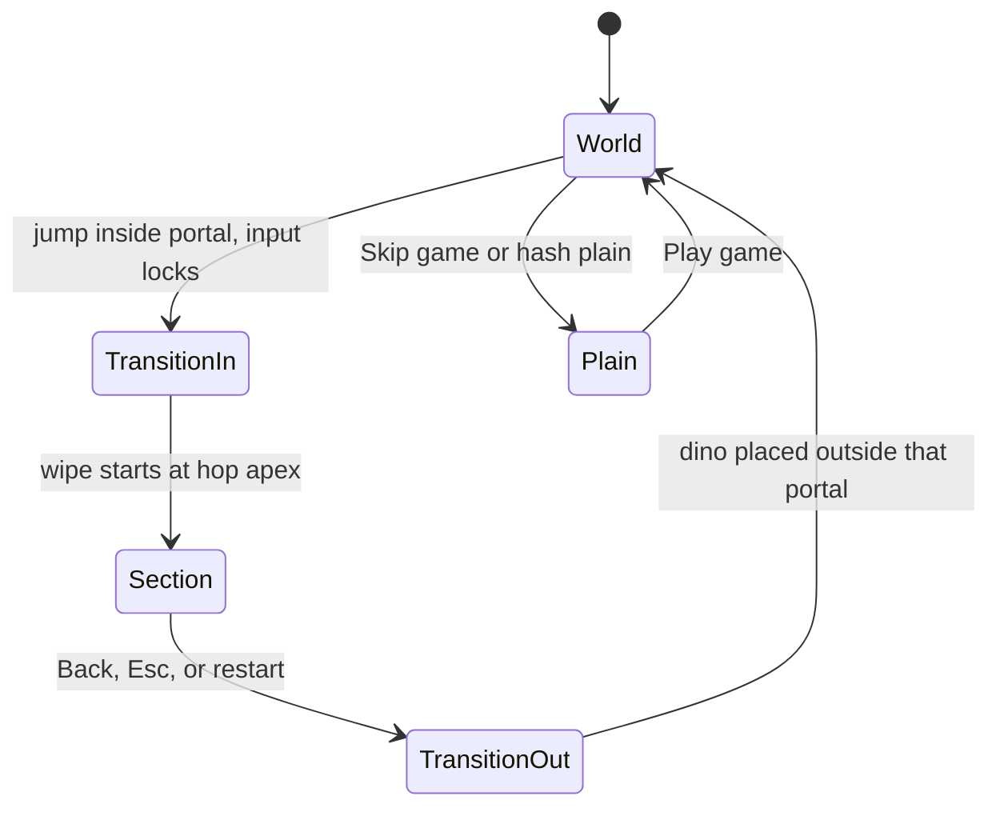

# T-Rex Portfolio Redesign

## 1. Approach

Confirmed stack: plain JS React 19 (`src/App.jsx`, `src/main.jsx`), Vite 8, Tailwind **v4.3.5** via `@tailwindcss/vite`. There is no `tailwind.config.js`. Theme tokens go in [`src/index.css`](src/index.css) with `@theme`. The only app code today is [`src/App.jsx`](src/App.jsx) (content, `LogoMarquee`, `ExpandableDescription`) plus a marquee keyframe. [`reference/dino_game/`](reference/dino_game) stays read-only and is never imported.

**Renderer: Canvas 2D, no Phaser or Kaplay.** The world is one 1x sprite sheet, a camera, and a few dozen `drawImage` calls. Canvas 2D matches how Chromium draws this game, keeps `imageSmoothingEnabled = false`, and adds no dependency. DOM sprites fight integer camera scrolling. A game library would own the loop and duplicate React.

**React owns the mode. A plain `Game` class owns the loop.** React does not re-render per frame. The loop writes canvas pixels and sets `transform` on a handful of label nodes.

**Decisions**
- World stays the day palette. Section screens use the inverted night palette, so the enter wipe reads as the game's night flip. Logos sit on a `#f7f7f7` tile and stay grayscale, with no invert.
- Portal names are Press Start 2P in the DOM. The sprite sheet has digits, `HI`, and `GAME OVER` only. It cannot spell About, Experience, or Projects.
- Body copy is VT323. Press Start 2P is titles, labels, HUD, and buttons only, at multiples of 8px and at least 16px.
- The renderer uses [`public/sprites/100-offline-sprite.png`](public/sprites/100-offline-sprite.png) only. Scale is one integer device-pixel factor `S`. The buffer is the full `innerWidth * dpr` by `innerHeight * dpr`, and `ctx.scale(S, S)` is the only transform scale.
- Jump physics use `normalJumpConfig` from [`reference/dino_game/trex.ts`](reference/dino_game/trex.ts) on a fake `z`. A held jump peaks around **90** game pixels (Chromium's rounded sim crests at 88–91; float integration of the loop below crests near 94). The old 68px figure is where `y < maxJumpHeight` fires, not the peak.
- Nothing is lethal. Cactus posts block with small base footprints. The gate opening is a non-solid trigger. Canvas sprites y-sort by foot y. DOM labels sit above the canvas and do not interleave with those pixels.
- The loop runs for `world` and `transition`. It pauses for `section`, `plain`, and a hidden tab. An internal `inputLocked` flag, not a paused loop, freezes control during the hop and wipe.
- The hash is the only mode source. `syncFromLocation()` runs on load, `popstate`, and `hashchange`, so Back and Forward share one path. The dialog `close` event is the exit signal, and exit is idempotent.
- `#about`, `#experience`, and `#projects` open that section in the game shell. `#plain` is the plain page.
- The exit control is the single restart-icon crop, sized in whole device pixels. Spin frame offsets stay unverified until that crop is on screen.

## 2. File tree

```
index.html                          title, description, 1x preload, noscript links
src/main.jsx
src/index.css                       @theme, body, marquee, pixelated, dialog
src/content.js                      verbatim copy
src/App.jsx                         mode shell, syncFromLocation, focus
src/components/PlainPage.jsx
src/components/SectionFrame.jsx     native dialog, exit, scroll
src/components/AboutSection.jsx
src/components/ExperienceSection.jsx
src/components/ProjectsSection.jsx
src/components/ExpandableDescription.jsx
src/components/LogoMarquee.jsx
src/components/ExitButton.jsx       single restart crop
src/components/Hud.jsx              hint, HI n/3, skip
src/components/TouchControls.jsx
src/components/World.jsx            canvas + label refs
src/game/Game.js                    loop owner, pause, destroy
src/game/constants.js
src/game/input.js
src/game/collision.js
src/game/atlas.js                   1x numbers, not a TS import
src/game/entities.js                dino, portals, clouds, ground
reference/dino_game/                untouched
public/sprites/                     renderer uses the 1x sheet
public/sounds/                      optional milestone only
THIRD_PARTY_NOTICES.md              extend the existing BSD line
```

New dependencies, fonts only: `@fontsource/press-start-2p`, `@fontsource/vt323`.

## 3. State machine



React state: `{ mode: 'world' | 'transition' | 'section' | 'plain', section: null | 'about' | 'experience' | 'projects', visited: Set }`.

`Game` callbacks: `onProximity(id | null)`, `onEnter(id)`. The loop keeps drawing through `transition` and pauses when the mode becomes `section` or `plain`. `game.destroy()` runs on unmount. StrictMode cleanup must `cancelAnimationFrame` and remove listeners before the second mount. Ignore a stale frame with a disposed flag. Ignore `onEnter` while `mode !== 'world'`.

**Hashes, via one `syncFromLocation()`.** It is the only writer of `mode`. Call it on load, `popstate`, and `hashchange`. `pushState` does not fire either event, so a gameplay enter calls it directly after updating the hash. Forward uses the same function as Back.
- Empty and `#world`: desert. Close the dialog if it is open.
- `#plain`: plain page. Close the dialog if it is open.
- `#about`, `#experience`, `#projects`: game shell with that section open. Place the dino at that portal's return point. A direct load, or Forward onto the hash, does not play the hop.

**Enter from play.** Set `mode` to `transition` and `inputLocked`. The loop keeps running. At the end of the wipe, `pushState` the section hash and call `syncFromLocation()`, which opens the dialog with `showModal()` and pauses the loop.

**Exit.** The dialog `close` event is the real signal. Chrome can skip `cancel`, and a second Esc can close the dialog immediately. `close` requests one idempotent exit: if an exit is already running, return; if the hash is still a section, `history.back()` when this visit pushed a state, otherwise `replaceState` to `#world` so a deep link does not leave the site. The following `popstate` or `hashchange` calls `syncFromLocation()`. If that call is what closed the dialog, `close` sees a non-section hash and returns. The restart button only calls `dialog.close()`. Leaving a section sets `mode` to `transition` for the reverse wipe, then `world`, then clears `inputLocked`. Skip pushes `#plain`.

## 4. Loop, input, movement, jump, triggers

**Loop.** `requestAnimationFrame`. `dt` in seconds, clamped to `0.05`. Keep stepping while `mode` is `world` or `transition`, so the enter hop and the wipe have frames. Pause only for `section`, `plain`, or `document.hidden`. `inputLocked` is an internal flag set at the enter jump edge and cleared when the desert resumes. It drops axes and jump edges. It does not stop the loop. On resize, recompute `S` and the canvas buffer. No allocations inside the frame.

**Input.** `input.js` tracks keys by `event.code` (`KeyW`, `KeyA`, `KeyS`, `KeyD`, `ArrowUp`, `ArrowDown`, `ArrowLeft`, `ArrowRight`, `Space`) and ignores `e.repeat`. `getAxis()` returns `x, y` in `-1..1`. Keyboard diagonals are divided by `sqrt(2)`. Joystick magnitude is clamped to 1. Jump is an edge from Space `keydown` or the jump button's `pointerdown`, not a hold-repeat. `preventDefault` on arrows and Space only while the world is playing. Listeners attach to `window` and come off in `destroy()`.

On `window` `blur`, and on `visibilitychange` when the document is hidden, clear the held-key set and every active pointer. A missed `keyup` must not leave the dino running.

Touch uses pointer events, not touch events. Each contact is stored by `pointerId`. The joystick and the jump button capture with `setPointerCapture` on `pointerdown`, so a drag that leaves the control still tracks and a second finger can hold the other control at the same time. Deadzone on the stick is 0.2.

**World.** 1600 by 960 game pixels (1 game pixel = 1 ldpi sprite pixel). Sky `y = 0..150`. Walkable ground `x = 24..1576`, `y = 180..920`.

**Scale.** One integer device-pixel scale, no second CSS scale and no `setTransform(dpr, ...)`:

```
S = max(round(2 * dpr), round(min(innerWidth, innerHeight) * dpr / 220))
canvas.style.width = innerWidth + 'px'
canvas.style.height = innerHeight + 'px'
bufferW = round(innerWidth * dpr)
bufferH = round(innerHeight * dpr)
ctx.setTransform(S, 0, 0, S, 0, 0)
ctx.imageSmoothingEnabled = false
ctx.translate(-camX, -camY)
```

`S` is an integer, so each sprite pixel is a whole number of device pixels. There is no second `dpr` transform. Style size is the CSS viewport. Round camera and sprite destinations to integers. Visible game size is `bufferW / S` by `bufferH / S`.

`round(innerWidth * dpr)` can be off by a pixel at dpr 1.25 and 1.5, and the browser then resamples the bitmap. On milestone 2, confirm those two densities are crisp. If they are not, size the buffer from `ResizeObserver` `devicePixelContentBoxSize` where the browser provides it, and keep the rounded product as the fallback.

**Camera.** Round to integers and clamp to the world. If the view is larger than the world on an axis, center the world and fill the margin with the desert color. Feet sit at `anchor * visibleH` from the top of the view:

```
headroom = 147 // 47 sprite + ~94 hop + 6 margin
anchor = clamp(headroom / visibleH, 0.5, 0.85)
```

A fixed 70% of a 195px view is 136.5, short of the ~141px the hop needs, and a landscape phone with browser UI is about 170–175 game pixels tall. The clamp keeps a tall portrait view at 0.5 and a short view at most 0.85. At 170px, `147 / 170` is about 0.86, so the cap wins and the hop is a few pixels tight. That is the bound. Do not use a fixed 65–70% anchor.

**Layout (opening centers).**
- Spawn: `(800, 760)`, facing right
- About: `(340, 460)`
- Experience: `(800, 300)`
- Projects: `(1260, 460)`
- Return spawn: same x, `y + 72`, which sits outside the trigger

**Movement.** `MOVE_SPEED = 180` game pixels per second (3 px per frame at 60fps). Velocity is `axis * MOVE_SPEED * dt` after normalization. Last horizontal direction is kept when `vx` is 0, including pure vertical movement. Run frames play only while speed is non-zero and `z === 0`. Idle holds the standing frame and blinks. While `inputLocked` is set, ignore axes and jump edges. The flag covers the hop and both wipes. The loop still draws.

**Footprint.** 28 by 12 AABB on the feet (bottom center of the 44 by 47 sprite). This is the dino's collision body. The side-view sprite does not collide with its full rectangle. `z` does not move the footprint.

**Jump, from [`trex.ts`](reference/dino_game/trex.ts) `normalJumpConfig`.** Per 60fps frame: `initialJumpVelocity = 10`, `gravity = 0.6`, `minJumpHeight = 30`, `dropVelocity = 5`. Integrate with `frames = dt * 60`, and keep physics in floats. Round only at draw time.

```
on jump edge, if z === 0:
  vz = 10 + horizontalSpeedPxPerFrame / 10
each frame:
  z += vz * frames
  vz -= 0.6 * frames
  if z >= 30: reachedMin = true
  if jump released and reachedMin and vz > 5: vz = 5
  if z > 100: z = 100
  if z <= 0: z = 0, vz = 0, airborne = false
```

`groundYPos` in the original is `150 - 47 - 10 = 93`. `maxJumpHeight: 30` is an absolute y test (`y < 30`), which fires after about 68px of rise. By then upward speed is already slower than `dropVelocity` (-5), so `endJump()` does not cut the hop. Chromium's rounded loop crests at **88–91** game pixels. Float integration of the loop above crests near **94**. Treat the peak as **~90**. The `z = 100` assignment is only a safety clamp for a bad timestep. Early release after `z >= 30` sets `vz` to 5 and trims about **10px**. That small gap between tap and hold is expected.

Draw the sprite at `y - z`. Shadow is a flat `#535353` pixel oval, about 30 by 8, drawn under the feet. Its width scales by `1 - z / 90 * 0.35`. There is no shadow sprite.

**Animation timings from `animFrames`.**
- Idle: source x offset `0`, 44 by 47. Blink offset `44` for `1000/3` ms, then a new delay of `3000..7000` ms (`BLINK_TIMING`).
- Run: offsets `88` and `132`, `1000/12` ms each.
- Airborne: offset `0` (the original jump frame is the standing pose).
- Duck (`264`, `323`) and crashed (`220`) are unused.

Flip with `scale(-1, 1)` around the sprite center when facing left.

**Gate.** Two large cacti, 25 by 50, with a 48px gap (wider than the 28px footprint). A small cactus, 17 by 35, sits 16px outside each post. The label is a DOM node centered above the posts. The opening is not solid.

**Y-sort.** After the sky, horizon, and clouds, sort the dino, both posts, and both flank cacti by foot y. Smaller foot y is farther away and draws first. The dino draws behind a cactus when its feet are higher on the screen, and in front when they are lower. DOM labels cannot weave between canvas pixels, so they are not in this sort and they do not get a `z-index` from foot y. Keep the labels in a layer above the canvas. A label can paint over a sprite. The proximity announcement is the aria-live cue. Canvas text was the other option and is not used, so the names stay DOM text.

**Colliders.** Posts and flanks block at the base only, not on the full sprite rectangle. Large post footprint about **25 by 8**. Small flank footprint about **17 by 6**. Resolve overlap on the smallest axis. Because `z` does not move the footprint, a jump does not pass through a post. No damage, no score, no game over. World bounds clamp the dino footprint.

**Trigger.** A 40 by 28 AABB centered in the gap. Overlap while `z === 0` shows the cue and sets `aria-live` to "About portal. Press Space to enter." (or "Tap jump" when touch controls are showing). The cue blinks at `1000/3` unless reduced motion is set. Enter only on the jump **edge** while the footprint overlaps and `z === 0`. Walking through does nothing. Landing inside does nothing. A jump that starts outside the box does not enter.

**Enter sequence.** On that edge, set `inputLocked` and `mode` to `transition`. The loop keeps running. When `vz` crosses to falling (the apex, around 90px), start the 400ms wipe. Keep the dino at the apex under the wipe. Then `pushState` the section hash and call `syncFromLocation()`, which opens the dialog and pauses the loop. `prefers-reduced-motion`: still lock input, skip the wipe, and sync the hash at the apex.

## 5. Rendering and atlas

Use the 1x sheet only. Preload [`public/sprites/100-offline-sprite.png`](public/sprites/100-offline-sprite.png) from [`index.html`](index.html). Start the loop after `img.decode()`. Do not switch on the 2x sheet. `getContext('2d', { alpha: false })`. Dest sizes are ldpi game pixels. Source rects are the ldpi atlas, unmultiplied.

Atlas numbers come from [`offline_sprite_definitions.ts`](reference/dino_game/offline_sprite_definitions.ts), [`trex.ts`](reference/dino_game/trex.ts), and [`game_over_panel.ts`](reference/dino_game/game_over_panel.ts).

**1x atlas.**
- T-Rex origin `(848, 2)`, frame size 44 by 47, offsets above
- Cloud `(86, 2)`, 46 by 14. Drift at `0.5 * 60 = 30` px/s in the sky band. About 4 clouds.
- Horizon `(2, 54)`, 600 by 12. Tile across the ground every 56px vertically. [`horizon_line.ts`](reference/dino_game/horizon_line.ts) uses `sourceY: 52`. If the y=54 crop clips the bumps, use 52. Check this on the first canvas milestone.
- Large cactus `(332, 2)`, 25 by 50. Small cactus `(228, 2)`, 17 by 35. Use the single-plant crop only. Colliders are the base footprints in section 4, not these rects.
- Restart `(2, 68)`, 36 by 32. Frame 0 is the crop the exit button uses. The reference lists later x offsets `36, 72, 108, 144, 180, 216, 252`. Those offsets are unverified until the frame-0 crop is on screen and the strip is checked. Do not build the spin from them before that.
- Pterodactyl `(134, 2)`, 46 by 40, two frames at `1000/6` ms. Optional milestone only.
- Moon `(484, 2)` and stars `(645, 2)` exist for the optional night toggle. Measure the crop then (classic sizes are a 20 by 40 moon and 9 by 9 stars).
- Text sprite `(655, 2)` is digits, `HI`, and `GAME OVER`. HUD text is the web font instead. Do not draw `GAME OVER`.

Both sheets were opened. They contain the dino frames, restart arrow, cacti, pterodactyls, clouds, ground line, moon phases, stars, digits, `HI`, and `GAME OVER`. They do not contain a letter alphabet or a shadow. The 2x sheet stays in the repo and is unused by the renderer.

Portal labels, the Space cue, and the HUD are DOM nodes above the canvas. The game loop sets `transform: translate3d(...)` from the camera so React does not render each frame. Label size keys off CSS pixels per game pixel, `S / dpr`, not off `S`. Use 16px when that ratio is 2, and 24px when it is 3 or more. Both are multiples of 8. Below 2, stay at 16px.

**Exit control.** A real `<button>` in the dialog, fixed top center, clear of the safe area. It shows the 1x crop at `(2, 68)`, 36 by 32. Draw it at an integer multiple `N` and size the button so its device-pixel box is exactly `36N` by `32N`. CSS size is that box divided by `dpr`. A fixed 72 by 64 CSS box is 2.5 device pixels per sprite pixel at dpr 1.25, so it is not crisp. `image-rendering: pixelated`. Visually hidden name: "Back to desert". Confirm this crop is the circular arrow before adding anything else. The 8-frame spin is optional, and its offsets are unverified until that crop is shown. `aria-keyshortcuts="Escape"`. The button calls `dialog.close()` only.

**Enter / exit transition.** 400ms, starting at the hop apex. `inputLocked` is set from the jump edge, and `mode` stays `transition` so the loop keeps drawing. Canvas gets `filter: invert(1)` and the dialog backdrop wipes in. `syncFromLocation()` then calls `showModal()` and the loop pauses because `mode` is `section`. The reverse wipe also runs as `transition` before the loop settles on `world`. `prefers-reduced-motion`: no wipe, no cloud drift, no run-cycle, no cue blink, no marquee. The hop still reaches the apex, and movement returns when `inputLocked` clears.

## 6. Content mapping

Move every string out of [`src/App.jsx`](src/App.jsx) into `src/content.js` unchanged, including apostrophe characters. Do not copy-edit.

`AboutSection` (also the top of `PlainPage`): `h1` Ethan Rose, intro line, "A bit about me" paragraph, LinkedIn, GitHub, Resume PDF, Contact Me, Hobbies as an `h2`.

`ExperienceSection`: `LogoMarquee`, then four roles. Each role is a title line, a meta line, and `ExpandableDescription` (truncate, Show more / Show less). Keep those button words.

`ProjectsSection`: three cards. Qflow links to `https://qflow.pooria.dev/` and uses `/qflow-screenshot.png`. HAVOC has no link and uses `/qret_image.webp`. SEO-Audit links to `https://github.com/Erose112/seo-audit` and uses `/seo-audit-screenshot.png`. Keep the existing alt text.

`PlainPage` stacks About, Experience, and Projects in one scrollable `main` with real headings. Section dialogs render the same components, one at a time.

**Copy notes, do not fix.**
- "Qflow a course scheduling" is missing a comma.
- "Queen's University student" is singular.
- "SEO based checks" is missing a hyphen.
- The Qflow heading is "Qflow Co-founder". HAVOC and SEO-Audit are project names.
- Contact Me points at the same LinkedIn URL as the LinkedIn link.
- The marquee includes UFlourish, and there is no UFlourish role.
- MEMOTEXT part-time (May 2025 – August 2025) overlaps SLR (June 2025 – August 2025).
- The about paragraph is present tense ("currently working"). The full-time MEMOTEXT description is past tense ("I was").
- Preserve apostrophes as they appear in `App.jsx` when moving the strings. Do not normalize them.

**Path bug.** [`src/App.jsx`](src/App.jsx) still requests `/Screenshot 2026-09-25 104047.png`. That file is not in `public/`. [`public/qflow-screenshot.png`](public/qflow-screenshot.png) is already there. Point the content module at it. No rename left to do.

**Logos.** Grayscale only. On night sections, each logo sits on a `#f7f7f7` tile with a 2px ink border so dark marks stay visible. Do not invert. Hover and focus clear the filter and show the original color. Alt text stays.

**Noscript.** [`index.html`](index.html) includes real links, not a hint to enable JavaScript:

```html
<noscript>
  <p>Ethan Rose</p>
  <ul>
    <li><a href="https://www.linkedin.com/in/ethan-rose-3382b1344/">LinkedIn</a></li>
    <li><a href="https://github.com/Erose112">GitHub</a></li>
    <li><a href="/Ethan_R_Software_Developer_Resume.pdf">Resume</a></li>
  </ul>
</noscript>
```

## 7. Tailwind theme

Extend [`src/index.css`](src/index.css). Do not add a JS config.

```css
@theme {
  --color-desert: #f7f7f7;
  --color-ink: #535353;
  --color-night: #080808;
  --color-night-ink: #acacac;
  --font-display: "Press Start 2P", ui-monospace, monospace;
  --font-body: "VT323", ui-monospace, monospace;
  --radius-none: 0px;
}
```

`#080808` and `#acacac` are the inverses of `#f7f7f7` and `#535353`. That pair is about 9:1, so night body text stays readable.

**Why these fonts.** Press Start 2P matches the HUD, and it is a poor paragraph face: each glyph is roughly a square, so a sentence becomes a wall of text. VT323 is a mono pixel face with a large x-height, still on-theme, and readable for the long experience blurbs. Pixelify Sans is rounder and less like this sprite sheet. Self-host both with `@fontsource` imports. No Google Fonts request.

**Minimum sizes.** Press Start 2P only at multiples of 8px, and nothing readable below 16px. Use 16px for HUD and buttons, 24px for section titles, and 32px for the name on large screens. Portal labels follow `S / dpr` as in section 5. "EXPERIENCE" at 16px is about 160px wide, so it fits a 320px screen. Render VT323 at 16, 24, and 32px and keep the smallest of those whose strokes stay even. Do not assume 20px. Line-height about 1.35.

**Look.** `border-2 border-ink` (or `border-night-ink`), square corners, no `shadow-*`, no gradients, no `blue-*`. Hover is an invert (`bg-ink text-desert`) or an underline. Buttons and cards use that border. `image-rendering: pixelated` on sprite elements. `-webkit-font-smoothing: none` on the display font.

**Dialog.** Native `<dialog>`, opened with `showModal()`. Reset the UA frame: margin 0, border 0, padding 0, width 100%, height `100dvh`, max-height `100dvh`, night background, ink text. The backdrop is the night fill. Padding-top clears the exit button plus `env(safe-area-inset-top)`.

**Body element.** Delete the `<body>` inside `App`. Set `margin: 0`, desert background, ink color, and `overflow: hidden` on the real body in CSS so the first paint matches. The plain page and the dialog set their own `overflow-y: auto`. Update the document title to "Ethan Rose" and add a meta description taken from the intro line.

Keep the existing marquee keyframes and the `prefers-reduced-motion` override.

## 8. Responsive and accessibility

**Desktop.** `S` follows the formula in section 4. The view is a window onto the 1600 by 960 world, not a fit-to-screen stretch. WASD, arrows, Space. The skip control sits top-left. `HI n/3` sits top-right, Press Start 2P at 16px, like the score.

**Mobile portrait.** The view is tall and narrow, so gates are walked to rather than seen together. The anchor formula lands on 0.5, so the feet stay centered. Show a joystick (left) and a jump button (right) when `(pointer: coarse)`. `touch-action: none` on the canvas and the controls. Joystick is CSS: square border, square knob. It is not a sprite. Insets use `env(safe-area-inset-*)`.

**Mobile landscape.** Same `S` rule. Browser UI leaves about 170–175 game pixels of height. The anchor becomes `clamp(147 / visibleH, 0.5, 0.85)`, which hits the 0.85 cap there. Controls sit above the bottom safe area and unmount while a section or the plain page is up.

**Sections.** The dialog is `100dvh` and scrolls inside. Cards stack in one column below `md` and go three-across from `md` up, matching the current project grid. The marquee can stay full-bleed inside the section. Logo tiles are `#f7f7f7` with grayscale art.

**Skip / plain page.** First focusable control, always visible in the game: "SKIP GAME". Plain view uses one `h1`, `h2`s, paragraphs, lists, and links. "PLAY GAME" returns to the desert.

**Keyboard-only play.** Canvas is `tabindex="0"` with `aria-label` describing WASD, arrows, and Space. Focus it on load and when returning from a section. Portal cue uses `aria-live="polite"` and does not repeat while you stay inside the box.

**Focus on enter and exit.** `showModal()` traps focus. After open, move focus to the section `h2`. When the dialog `close` event runs the idempotent exit, return focus to the canvas and announce "Back in the desert, at the About portal." The restart button is a button, so Enter and Space work when it is focused. Esc closes the dialog. Do not depend on `cancel`. A repeated Esc must not start a second exit.

**Reduced motion.** Instant wipe, frozen run frame, still clouds, still marquee, no blinking cue. Input still locks until the section opens. The game remains playable.

**SEO.** Title and meta description in `index.html`. The noscript block has the name plus working LinkedIn, GitHub, and resume links. Copy is real text when a section or the plain page is showing. Images keep their alt text. Project and social links keep `target="_blank"` and `rel="noopener noreferrer"`. This stays a client-rendered SPA. Do not duplicate the whole biography in `index.html`.

## 9. Milestones

Each one is shippable on its own and checkable in the browser.

1. **Content and theme.** Extract `content.js`, theme, fonts, layout wrapper, fix the Qflow image path, render `PlainPage` only, add the noscript links. Acceptance: every current string and link is present, resume opens, descriptions expand, no nested `body`, no blue or rounded Tailwind chrome, Press Start 2P is 16px or another multiple of 8, VT323 is whichever of 16, 24, and 32px keeps even strokes, and with JS disabled the name, LinkedIn, GitHub, and resume links are visible.
2. **Static world.** 1x atlas, preload, canvas, horizon tiles, clouds, idle dino. Acceptance: sprites are unsmoothed at dpr 1, 2, and 3, and specifically at 1.25 and 1.5. One game pixel is `S` device pixels. If `round(innerWidth * dpr)` resamples at 1.25 or 1.5, the buffer comes from `ResizeObserver` `devicePixelContentBoxSize` where supported. The exit button's device-pixel box is a whole multiple of 36 by 32. The standing and blink frames crop correctly. The horizon crop is not clipped. StrictMode remount leaves a single loop.
3. **Move and jump.** Keyboard `code`s, no repeat, blur clears keys, normalized diagonals, camera anchor, run cycle, shadow, jump arc. Acceptance: diagonal speed matches axis speed; a held jump peaks near 90 game pixels (about 88–94); releasing early trims about 10px; feet sit at `clamp(147 / visibleH, 0.5, 0.85)` of the view, including a ~170–175px landscape height; hiding the tab pauses the loop, clears held keys, and does not teleport on return. The loop still runs during `transition`.
4. **Portals.** Three gates, base footprints, canvas y-sort, DOM labels above the canvas, cues, jump-to-enter callback, return coordinates. Acceptance: walking through a gate does not fire; jumping inside does; jumping from outside does not; the dino cannot leave the walkable rect; posts block only on the ~25 by 8 and ~17 by 6 bases; the dino draws behind a cactus when its feet are higher on screen; labels stay above the canvas and are not z-index sorted. Label size is 16px at `S / dpr` of 2 and 24px at 3 or more.
5. **Sections.** Mode machine, hop then wipe at the apex with `inputLocked` while the loop still runs, native `showModal()` dialog, single-frame restart crop, `syncFromLocation`. Acceptance: the wipe does not start before the apex; the loop is still drawing through `transition` and paused in the section; text is selectable; links work; Show more works; Back, Forward, Esc, and the restart button each settle on one state; a second Esc does not run the exit twice; a deep link does not navigate off the site; the exit image is the circular-arrow crop at a whole device-pixel size; spin offsets stay unused until that crop is checked; reduced motion skips the wipe.
6. **Phone, skip, HUD, focus.** Pointer-capture joystick and jump button together, portrait and landscape, safe areas, `100dvh` dialog, skip and hashes, `HI n/3`, live region, focus moves. Acceptance: a phone-width viewport can reach all three gates and scroll a section; joystick and jump work at the same time; `#about` opens the game-shell dialog and `#plain` opens the plain page; Forward returns to a section after Back; keyboard-only play can enter and leave.
7. **Load and credit.** Preload the 1x sheet, lazy section images, footer line, a README line, extend [`THIRD_PARTY_NOTICES.md`](THIRD_PARTY_NOTICES.md). Acceptance: the 1x sheet is requested early, section images are not in the first load, the BSD credit is visible on the plain page and in the notices file.

**Optional, after the core.** The restart-button spin, only after the frame-0 crop is confirmed and the x offsets are checked against the sheet. Until then those offsets are unverified. Muted-by-default audio (`button-press` on jump and exit, `score-reached` when the counter increments). Do not play `hit.mp3`. It is a death sound. A day/night toggle for the world using the moon and stars. A decorative pterodactyl on a timer, with no collision.

## 10. Risks

- `maxJumpHeight: 30` fires about 68px into the rise and is not the peak. The peak is ~90. Clamping `z` at 72 would cut the hop. The only clamp is 100.
- Early release trims ~10px. A larger trim means `dropVelocity` was applied wrong.
- Horizon source y is 54 in the sprite definitions and 52 in the line config. The first canvas milestone has to confirm the crop.
- A fixed 70% camera anchor is short of the hop on a 195px view (136.5 vs ~141) and worse on a 170px landscape phone. The anchor is `clamp(147 / visibleH, 0.5, 0.85)`. The 0.85 cap can still clip a few pixels at ~170px.
- `round(innerWidth * dpr)` can resample at dpr 1.25 and 1.5. Milestone 2 switches to `devicePixelContentBoxSize` if that shows up. The exit button needs the same whole-device-pixel treatment.
- Press Start 2P below 16px, or at a size that is not a multiple of 8, breaks the pixel grid and is hard to read. Body copy must not use it. VT323 at 16, 24, or 32px can stroke unevenly. Keep the size that does not.
- DOM labels always paint above the canvas. A cactus can pass under a name. That is accepted so the labels stay real text.
- The dialog `close` event can fire from Esc, from `dialog.close()`, and from `syncFromLocation` closing it. Exit has to no-op on the second call. Depending on `cancel` misses the Chrome path that skips it.
- A direct `#about` load has no pushed entry. `syncFromLocation` must `replaceState` to `#world` instead of backing out of the site.
- Restart spin offsets from the reference are unverified until the crop is visible.
- iOS will zoom or scroll if Space or `pointermove` is not handled only on the game surface. Do not `preventDefault` while a section is scrolling.
- StrictMode double-mount will start two loops if `destroy()` does not cancel the frame.
- No test runner in `package.json`. Collision and the jump step can be checked with a small `node --test` file later. Milestones 1 through 6 are browser checks.
- Client-rendered text is what Google will see after JS. The noscript block covers the name and the three links only.

Non-blocking defaults already chosen: game first, plain page behind Skip. Visited count lives in React state for the session only. Sections are night, the desert is day. Space does not globally close a section.

## 11. Assets

Present and usable: both sprite sheets, all three mp3s, `memotext-logo.png`, `queens-logo.png`, `slr-logo.jpg`, `u-flourish.png`, `qret_image.webp`, `seo-audit-screenshot.png`, `qflow-screenshot.png`, the resume PDF, and every file in [`reference/dino_game/`](reference/dino_game). [`THIRD_PARTY_NOTICES.md`](THIRD_PARTY_NOTICES.md) already has the Chromium BSD line.

The renderer uses the 1x sheet only. The 2x sheet is unused.

Not on the sprite sheet, and not required as files: an alphabet, a shadow, a joystick graphic. The exit arrow, cacti, clouds, ground, and dino frames are all on the 1x sheet. Show the restart crop on the button before treating the later spin offsets as real. Those offsets are unverified.

Stale reference only: the spaced screenshot name in `App.jsx`. The file on disk is already `qflow-screenshot.png`.
